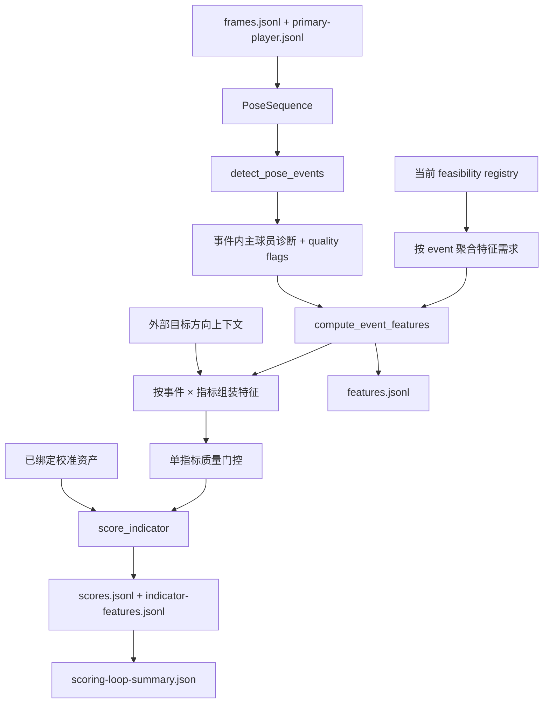
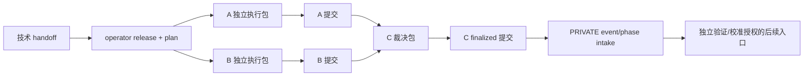

# 评分、技术分析、真值、评估与训练：源码逻辑详解

本文按当前工作区源码分析，日期为 2026-10-09。重点解释 `rallymate_scoring`、`rallymate_annotation`、`rallymate_evaluation`、`rallymate_pose_evaluation`、`rallymate_training`、`rallymate_visualization` 以及关联契约和研究脚本。没有运行 GPU 推理或训练，没有改变业务实现；下文所说“实现了”表示存在可执行代码，不表示当前已有足够真值、已经训练成功或已经正式上线。

## 1. 首先分清四种完全不同的“分数”

| 层次 | 数据含义 | 当前代码行为 | 关键源码 |
|---|---|---|---|
| Pose/特征观测 | 关节角度、速度、时差、稳定时长等可观测量 | 输出 value/unit/valid/confidence/source_frames；可以测出来却不能评分 | [loop.py:444](C:/Users/Admin/Documents/网球/src/rallymate_scoring/loop.py:444) |
| 技术证据就绪度 | 视频是否提供某类技术需要的证据 | `evidence_score_0_to_100`，不是技术质量；正式 score/grade 固定 null | [technique_assessment.py:713](C:/Users/Admin/Documents/网球/src/rallymate_scoring/technique_assessment.py:713)、[785](C:/Users/Admin/Documents/网球/src/rallymate_scoring/technique_assessment.py:785) |
| 产品训练参考分 | 服务层用于反馈展示的参考 0–100 | 由 service 下 training_evaluation、user_demo 等单独计算；不由正式评分循环定义 | [training_evaluation.py:37](C:/Users/Admin/Documents/网球/src/rallymate_service/training_evaluation.py:37)、[user_demo.py:551](C:/Users/Admin/Documents/网球/src/rallymate_service/user_demo.py:551) |
| 正式 A–E | 经教练真值标定、独立测试、逐级晋升并绑定实际运行条件的单项等级 | `scored` 才有 grade；缺少任何必要证据时返回 `calibration_required` 或 `unavailable` | [scoring.py:192](C:/Users/Admin/Documents/网球/src/rallymate_scoring/scoring.py:192) |

最重要的边界：正式循环明确只定义“事件 × 指标”的单项等级，没有定义整场总分、综合 A–E 或等级平均。[loop.py:201](C:/Users/Admin/Documents/网球/src/rallymate_scoring/loop.py:201) 因而页面上存在一个参考分，并不意味着评分注册表已具备 F4 能力。

## 2. 注册表不是一个文件，而是分工明确的一组契约

### 2.1 当前运行权威

`registry-lifecycle.json` 明确指定当前 `runtime_feasibility` 是 `metric-feasibility-pose-wave-v2.json`，版本 `pose-wave-2026-10-01.2`；`current_scoring_requirements` 指向对应要求快照。旧的 `metric-feasibility.json` 标记为 historical，`metric-measurement-plans.json` 标记为 planning_only。不能通过文件名里是否有 v2、修改日期或指标数量猜哪份生效。[registry-lifecycle.json:6](C:/Users/Admin/Documents/网球/registry-lifecycle.json:6)、[26](C:/Users/Admin/Documents/网球/registry-lifecycle.json:26)

`resolve_registry_role()` 从固定 role 解析文件，使用已核验的原始字节、SHA-256 和内嵌版本返回 `ResolvedRegistryArtifact`；`validate_registry_lifecycle_artifacts()` 还核对派生 requirements 所绑定的 registry 内容。[registry_lifecycle.py:487](C:/Users/Admin/Documents/网球/src/rallymate_scoring/registry_lifecycle.py:487)、[521](C:/Users/Admin/Documents/网球/src/rallymate_scoring/registry_lifecycle.py:521)

当前运行注册表共有 13 项、全部标为 F2，事件范围是 FS01 分腿垫步、FS02 第一步启动、FS09 制动与稳定。旧表只有 6 项，`TARGET_INDICATORS` 为兼容历史导入故意仍保留 6 项，完整扩展集合另叫 `POSE_WAVE_V2_INDICATORS`。[feasibility.py:9](C:/Users/Admin/Documents/网球/src/rallymate_scoring/feasibility.py:9) **F2 在这里不能解释为已校准、已验证准确率或已获正式评级资格。**

### 2.2 不同注册表各负责什么

| 文件 | 实际职责 | 容易误读的地方 |
|---|---|---|
| `metric-feasibility-pose-wave-v2.json` | 每个运行指标的 maturity、required_events、required_features、版本与适用条件 | 运行时权威；13 项全 F2 |
| `indicator-scoring-requirements-pose-wave-v1.json` | 从当前注册表冻结独立测试必须检查的事件/phase/语义/特征要求 | 防止测试时删掉难验证的要求；生成入口 [indicator_requirements.py:100](C:/Users/Admin/Documents/网球/src/rallymate_scoring/indicator_requirements.py:100) |
| `metric-measurement-plans.json` | 将来源计算条款映射为观测原语、缺口、建议实现路径 | 是规划，不是全部功能已经实现；[measurement_plans.py:130](C:/Users/Admin/Documents/网球/src/rallymate_scoring/measurement_plans.py:130)、[419](C:/Users/Admin/Documents/网球/src/rallymate_scoring/measurement_plans.py:419) |
| `data/metric_cards.json` | 从来源整理的 298 张指标卡，供 granularity/readiness 分析 | 298 张卡不等于线上已实现 298 个评分函数；[granularity.py:37](C:/Users/Admin/Documents/网球/src/rallymate_scoring/granularity.py:37) |
| `data/technique_metrics.json` | 24 类定性技术定义、5 个 family、阶段、必需/增强证据、proxy 限制 | 定性 catalog，不包含已启用的数值教练评分；[technique_registry.py:80](C:/Users/Admin/Documents/网球/src/rallymate_scoring/technique_registry.py:80) |
| `data/technical_review_rules.json` | 298 条评分来源规则与 246 条视觉条款，保留来源文档、段落定位和哈希 | `machine_calibration_asset=false`、`numeric_grade_mapping=null`；内容在该单行 JSON 的第 1 行 |
| `scoring-blocker-taxonomy.json` | 拦截原因分类、对应真值要求和面向用户的解释 | 是质量/证据词汇表，不是 A–E 阈值；[blocker_taxonomy.py:171](C:/Users/Admin/Documents/网球/src/rallymate_scoring/blocker_taxonomy.py:171) |

### 2.3 F0 → F4 是逐步证据晋升

`assess_feasibility_promotion()` 只允许一次前进一步；例如 F2 直接到 F4 会返回 `promotion_must_advance_exactly_one_level`，函数本身不修改注册表。[feasibility.py:37](C:/Users/Admin/Documents/网球/src/rallymate_scoring/feasibility.py:37)

| 晋升 | 必要证据 |
|---|---|
| F0→F1 | event_layer 已 verified，包含指标要求的 event code，具有 event contract version |
| F1→F2 | feature_layer 已 verified，覆盖 required_features，真实毫秒时间与缺失值策略已经验证，具有 feature library version |
| F2→F3 | 事件评估、特征评估、等级可分性、教练一致性、内部校准以及带 protocol/reviewer 的验收决策 |
| F3→F4 | 独立测试 passed，approved_for_scoring=true，dataset/report/protocol/evaluated_at/report_sha256、calibration version、test split manifest 齐全 |

对应实现分别在 [feasibility.py:64](C:/Users/Admin/Documents/网球/src/rallymate_scoring/feasibility.py:64)、[75](C:/Users/Admin/Documents/网球/src/rallymate_scoring/feasibility.py:75)、[89](C:/Users/Admin/Documents/网球/src/rallymate_scoring/feasibility.py:89)、[109](C:/Users/Admin/Documents/网球/src/rallymate_scoring/feasibility.py:109)。数值验收界限必须来自外部预先登记的 protocol，此函数不自行编造“误差低于多少就是可用”。完整生产晋升还会验证 `maturity_evidence.py` 中 F0→F4 的连续哈希证据链。[maturity_evidence.py:610](C:/Users/Admin/Documents/网球/src/rallymate_scoring/maturity_evidence.py:610)、[746](C:/Users/Admin/Documents/网球/src/rallymate_scoring/maturity_evidence.py:746)

## 3. 线上正式评分循环：数据怎样走一遍

主要入口是 `run_minimum_scoring_loop()`，感知 pipeline 在逐帧产物与主球员时间线生成后调用它。[pipeline.py:863](C:/Users/Admin/Documents/网球/src/rallymate_vision/pipeline.py:863)

详细顺序如下。

1. **读取并验证注册表**。将所有指标按 event code 分组，取 required measurement features 的并集，再加入细足部 supplemental features。一个事件的同名特征只计算一次、被不同指标复用。[loop.py:217](C:/Users/Admin/Documents/网球/src/rallymate_scoring/loop.py:217)
2. **读 frames 和 primary timeline**，验证当前指标要求的 primary-player 算法版本，再构建 PoseSequence，组合 pose/model/feature/event/quality 等版本与 provenance。[loop.py:240](C:/Users/Admin/Documents/网球/src/rallymate_scoring/loop.py:240)
3. **如提供 production calibration，先绑定运行环境**。没有 trusted runtime binding registry、accepted video view evidence 或 video SHA，直接拒绝；video id/hash 必须精确相同，源视频仍存在时会重新哈希。[loop.py:261](C:/Users/Admin/Documents/网球/src/rallymate_scoring/loop.py:261)
4. **检测事件，再诊断事件区间内主球员质量**。诊断 flags 与 detector flags 合并，保存 `events.jsonl`。[loop.py:304](C:/Users/Admin/Documents/网球/src/rallymate_scoring/loop.py:304)
5. **如提供 target context，绑定到正确视频和事件边界**。不能唯一精确匹配的 accepted 上下文报错；完全在分析裁剪窗口之外的上下文可以忽略。移动方向永远不会被推断为“应该移动的目标方向”。[loop.py:321](C:/Users/Admin/Documents/网球/src/rallymate_scoring/loop.py:321)
6. **逐事件提取特征**。由 EventInterval 包含 event id/code/start/end/person_track_id/key_phases，调用 `compute_event_features()`，每条结果追加视频/事件/来源/版本信息。[loop.py:403](C:/Users/Admin/Documents/网球/src/rallymate_scoring/loop.py:403)
7. **按指标组装两套特征**：`features` 是纯观测层可以测的特征，`scoring_features` 是正式评分需要的完整集合，FS02-M02 会额外包含“相对外部目标方向的误差”；`supplemental_features` 单独报告，不静默改变已有评分输入。[loop.py:444](C:/Users/Admin/Documents/网球/src/rallymate_scoring/loop.py:444)、[511](C:/Users/Admin/Documents/网球/src/rallymate_scoring/loop.py:511)
8. **调用 score_indicator**，把 feasibility、event flags、校准资产、版本和可追溯 source_frames 一起传入；保留测量状态和评分状态的区别。[loop.py:547](C:/Users/Admin/Documents/网球/src/rallymate_scoring/loop.py:547)
9. **保存产物**：`features.jsonl`、`indicator-features.jsonl`、`scores.jsonl`、来源对齐测量、`event-feature-errors.json`，最后汇总到 `scoring-loop-summary.json`。汇总内还有所有关键产物 SHA。[loop.py:601](C:/Users/Admin/Documents/网球/src/rallymate_scoring/loop.py:601)、[811](C:/Users/Admin/Documents/网球/src/rallymate_scoring/loop.py:811)
10. **没有人工真值时不宣称评估完成**。线上调用 `evaluate_feature_errors(sequence, None, events, None, ...)`，得到 `ground_truth_required`；独立离线评估器日后可生成真正的误差报告。[loop.py:612](C:/Users/Admin/Documents/网球/src/rallymate_scoring/loop.py:612)

### 3.1 FS02-M02 的外部方向为什么特殊

`launch_direction_deg` 仅代表已经发生的图像平面运动；“应该向哪走”需要独立上下文。两者都有且有效时，计算：

`signed_error = (observed - target + 180) % 360 - 180`

`target_direction_alignment_error_deg = abs(signed_error)`

confidence 取运动方向置信度与参考方向置信度的较小值。任何必需输入缺失就返回 `value=null, valid=false, confidence=0`；0 度是实际完全对齐，不是缺失替代值。坐标约定是图像向右 0°、向上 90°。[scoring_context.py:105](C:/Users/Admin/Documents/网球/src/rallymate_scoring/scoring_context.py:105)、[114](C:/Users/Admin/Documents/网球/src/rallymate_scoring/scoring_context.py:114)

### 3.2 来源对齐测量是附加产物

`write_source_aligned_assessment()` 调用 features 层 source alignment，只为 FS01/FS09 生成来源语义测量，绑定视频、frames、events、primary timeline 哈希，先写临时文件再替换为 `source-aligned-measurements.json`。其 `technical_grade` 与 `technical_score_0_to_100` 明确为 null；它没有覆写旧的 scores。[source_assessment.py:37](C:/Users/Admin/Documents/网球/src/rallymate_scoring/source_assessment.py:37)

## 4. 单指标状态机和质量门控

### 4.1 score_indicator 的短路顺序

| 顺序 | 条件 | 结果 |
|---|---|---|
| 1 | 事件质量 hard_fail | unavailable，grade=null，confidence=0 |
| 2 | 特征名非法/重复 | 抛 ValueError，拒绝含糊输入 |
| 3 | 任一传入必需特征 invalid | unavailable；保留特征供诊断 |
| 4 | 测量允许但 scoring_allowed=false | unavailable；可保留 F2 测量 |
| 5 | 没有 calibration | calibration_required；原因是缺教练标定/独立测试 |
| 6 | 有 production asset，但注册表、特征集合、runtime profile 不匹配 | calibration_required 或特征契约不匹配 unavailable |
| 7 | production 对应指标不是 F4 | calibration_required |
| 8 | 独立测试未 passed/未 approved，或 test_only 未显式放行 | calibration_required |
| 9 | production 只是普通字典，没有受信包装对象 | calibration_required |
| 10 | 全部通过 | 才运行 threshold_rule/ordinal_regression，输出 scored |

源码顺序见 [scoring.py:203](C:/Users/Admin/Documents/网球/src/rallymate_scoring/scoring.py:203)、[227](C:/Users/Admin/Documents/网球/src/rallymate_scoring/scoring.py:227)、[252](C:/Users/Admin/Documents/网球/src/rallymate_scoring/scoring.py:252)、[271](C:/Users/Admin/Documents/网球/src/rallymate_scoring/scoring.py:271)、[290](C:/Users/Admin/Documents/网球/src/rallymate_scoring/scoring.py:290)、[390](C:/Users/Admin/Documents/网球/src/rallymate_scoring/scoring.py:390)、[413](C:/Users/Admin/Documents/网球/src/rallymate_scoring/scoring.py:413)、[440](C:/Users/Admin/Documents/网球/src/rallymate_scoring/scoring.py:440)。前面的失败会优先决定主要状态，但 `_append_concurrent_scoring_blocks()` 会同时保留其他评分拦截解释，防止一个原因遮盖另一种风险。[scoring.py:174](C:/Users/Admin/Documents/网球/src/rallymate_scoring/scoring.py:174)

### 4.2 hard_fail 与 scoring_block 的区别

`evaluate_indicator_event_quality()` 只消费已有 flags，不凭覆盖率重新猜 flag；输出 measurement_allowed 和 scoring_allowed 两个开关。未知 flag 保留为 advisory/unclassified，并不会自动变成 undocumented hard fail。[quality_policy.py:264](C:/Users/Admin/Documents/网球/src/rallymate_scoring/quality_policy.py:264)

| 诊断 | 测量 | 正式评级 |
|---|---|---|
| required_phase_missing:* | 阻止 | 阻止 |
| primary_track_coverage_low / confirmed id switch | 阻止 | 阻止 |
| restabilization_not_observed | 对 FS09-M04/M05 阻止，其余仅提示 | 对相应指标阻止 |
| primary_pose_coverage_low | 特征自身有效时仍可 F2 测量 | 阻止 |
| pose_kinematic_coverage_low（事件边界证据不足） | 有效测量保留 | 阻止 |
| source_track_switch_candidates_present / primary_identity_ambiguous | 保留候选诊断与有效测量 | 阻止 |
| tactical_target_direction_not_observed | 可保留其他观测 | 对 FS02-M02 阻止 |
| lead_foot_side_ambiguous | 依特征有效性决定 | 对 FS02-M03/M04/M05 阻止 |
| phase 的低样本/右截断峰值回退 | 可保留可审计时间点 | 对确实依赖该 phase 的指标阻止 |
| event_ground_truth_missing / provisional_rule_baseline | 不阻止测量 | 不独立构成 quality hard fail；仍须校准成熟度门 |

上述映射定义见 [quality_policy.py:22](C:/Users/Admin/Documents/网球/src/rallymate_scoring/quality_policy.py:22)、[43](C:/Users/Admin/Documents/网球/src/rallymate_scoring/quality_policy.py:43)、[74](C:/Users/Admin/Documents/网球/src/rallymate_scoring/quality_policy.py:74)、[96](C:/Users/Admin/Documents/网球/src/rallymate_scoring/quality_policy.py:96)、[287](C:/Users/Admin/Documents/网球/src/rallymate_scoring/quality_policy.py:287)。特别是 knee/ankle 等参与的指标与不参与的指标不能一刀切：代码从 FEATURE_DEFINITIONS 导出 required joints；只有诊断明确涉及完全不相交的关节集合，才把 jump/swap 降为“指标无关”。旧事件缺关节级证据时保留宽门控。[quality_policy.py:147](C:/Users/Admin/Documents/网球/src/rallymate_scoring/quality_policy.py:147)、[175](C:/Users/Admin/Documents/网球/src/rallymate_scoring/quality_policy.py:175)

## 5. 正式 A–E 的两种已实现计算后端

### 5.1 单特征阈值规则

等级有序集合 `GRADES=(E,D,C,B,A)`。标定资产必须给出一个 primary_feature、严格递增的 4 个有限阈值、方向、单位、feature version 和真值来源。[calibration.py:14](C:/Users/Admin/Documents/网球/src/rallymate_scoring/calibration.py:14)、[287](C:/Users/Admin/Documents/网球/src/rallymate_scoring/calibration.py:287)

对值 x，令 `k=sum(x>=t_i)`，k∈{0,1,2,3,4}。higher_is_better 时选 GRADES[k]，lower_is_better 时选 GRADES[4-k]。恰等于阈值归入更高数值区间。confidence 沿用该特征 confidence；返回 threshold_version、calibration version、独立测试报告与信任绑定来源。[scoring.py:481](C:/Users/Admin/Documents/网球/src/rallymate_scoring/scoring.py:481)

### 5.2 多特征有序回归

按资产 feature_order 取值，每个单位和 feature_version 必须完全匹配。计算 `eta=intercept+Σ(beta_j*x_j)`，四个累积概率 `C_i=sigmoid(cutpoint_i-eta)`，五级概率依次为 `[C1,C2-C1,C3-C2,C4-C3,1-C4]`。取最大概率等级；confidence=`max(probabilities)*min(feature_confidences)`，并保存每个等级概率。[scoring.py:538](C:/Users/Admin/Documents/网球/src/rallymate_scoring/scoring.py:538)

这两个后端都不会自己替缺失特征填值，也不会直接消费来源文档里的定性 A–E 条款来变成数值阈值。版本或单位冲突抛异常，避免“同名但不同算法”的特征进入旧模型。

## 6. 定性技术评估与动作时序分析

### 6.1 24 类技术 catalog

5 个 family 是 baseline、serve、return、net_attack、footwork；共 24 类：底线 5、发球 1、接发 5、网前 3、步伐 10。技术定义来自 `technique_metrics.json`，由 loader 严格校验并将一次不可分割字节快照的哈希绑定到任务；任务提交时与评估时的版本/哈希漂移会抛 `TechniqueRegistrySnapshotError`。[technique_registry.py:247](C:/Users/Admin/Documents/网球/src/rallymate_scoring/technique_registry.py:247)、[technique_assessment.py:672](C:/Users/Admin/Documents/网球/src/rallymate_scoring/technique_assessment.py:672)

事件映射包括 GS01–GS11、FS01–FS10，中文/英文别名会被规范化。**映射表存在不表示 detector 已经实现所有这些事件**；只有运行输入真的提供事件证据，技术才标 observed。[technique_assessment.py:85](C:/Users/Admin/Documents/网球/src/rallymate_scoring/technique_assessment.py:85)、[329](C:/Users/Admin/Documents/网球/src/rallymate_scoring/technique_assessment.py:329)

证据就绪度算法：

- required_score = 所有 required_evidence 覆盖率的最小值，体现最弱必需项；空集合默认为 0。
- enhanced_score = 所有 enhanced_evidence 覆盖率的算术平均；没有增强项为 0。
- evidence_score = round(100 × (0.7 × required_score + 0.3 × enhanced_score))。
- 未 observed 时 score 展示为 0、状态 not_observed；已 observed 且 required_score<0.4 为 unavailable，<0.72 为 partial，否则 ready。
- overall/family 的 evidence score 只对 observed 技术取无权平均；没有 observed 则 null。

实现见 [technique_assessment.py:558](C:/Users/Admin/Documents/网球/src/rallymate_scoring/technique_assessment.py:558)、[754](C:/Users/Admin/Documents/网球/src/rallymate_scoring/technique_assessment.py:754)、[805](C:/Users/Admin/Documents/网球/src/rallymate_scoring/technique_assessment.py:805)。0.4、0.72、0.7/0.3 是 service operational gate，不是教练技术等级阈值；结果明确 `formal_score_available=false`。[technique_assessment.py:827](C:/Users/Admin/Documents/网球/src/rallymate_scoring/technique_assessment.py:827)

### 6.2 phase 与 contact 的证据边界

phase 必须有明确对应同一 technique 的记录才标 measured；仅 observed event 时是 proxy；没有事件是 unavailable。通用的 recovery/support 字符串不能把其他技术的阶段串联认证，候选事件也不会认证正式 phase。[technique_assessment.py:506](C:/Users/Admin/Documents/网球/src/rallymate_scoring/technique_assessment.py:506)

contact policy 只是窗口提示：无 strike 阶段则 not_applicable；ball 与 racket 都有任何正覆盖为 contact_window_proxy；只有一个为 impact_window_only；都没有为 unavailable。使用的是 run-level coverage，尚非同一事件的 ball/racket 对应；`event_window_detection=false`、`accuracy_claim=false`，不影响正式评分。[technique_assessment.py:45](C:/Users/Admin/Documents/网球/src/rallymate_scoring/technique_assessment.py:45)、[629](C:/Users/Admin/Documents/网球/src/rallymate_scoring/technique_assessment.py:629)

### 6.3 stroke_candidates → motion_analysis

`recognize_strokes_from_artifacts()` 可直接从已有 frames 和 primary timeline 计算，不加载 GPU 模型。时间线缺失/损坏时返回 unavailable、count=null，而不是“0 次击球”。[stroke_candidates.py:455](C:/Users/Admin/Documents/网球/src/rallymate_scoring/stroke_candidates.py:455)

处理路径：筛选 selected 且身份不模糊的主球员 → 读取 Pose 样本 → 关联球拍 → 处理相机运动补偿与 reference epoch → 按连续轨迹检测挥拍/发球式候选 → 从候选构造 episode → 生成二维阶段和运动指标。所有其他球员轨迹仅用于潜在接发的上下文。fps_fallback 时间或未补偿 moving/unavailable camera 会切断连续段。ball 上下文至少要求合法 track、bbox、真实时间和 confidence≥0.45。[stroke_candidates.py:348](C:/Users/Admin/Documents/网球/src/rallymate_scoring/stroke_candidates.py:348)

episode 会在 candidate 前后扩展最多 650/900ms，但不跨持拍腕缺失、身份改变、几何跳变或 160ms 的观测间隔；至少需 7 个样本。输出准备、加速挥拍、随挥阶段、手腕峰速、路径长、肘角幅度、肩髋轴变化。肘角只取最长连续有效段，覆盖不足 80% 不输出范围。[stroke_analysis.py:57](C:/Users/Admin/Documents/网球/src/rallymate_scoring/stroke_analysis.py:57)

接发推断额外要求对手发球与同一条朝主球员运动的 ball track 衔接当前挥拍；不是看到一段挥拍就称接发。episode 重叠并且峰相差<400ms、重叠超过较短段一半时合并，以免一个真实挥拍重复计数。最终始终 `contact_confirmed=false`。[stroke_analysis.py:204](C:/Users/Admin/Documents/网球/src/rallymate_scoring/stroke_analysis.py:204)

### 6.4 可替换 temporal backend 的真实含义

`TemporalRecognitionBackend` 是接口，默认 `RuleTemporalBackend` 是 deterministic rules；不是已经训练好的网球时序神经网络。替换 backend 失败、返回 None 或非法输出时，会显式记录 fallback_reason 并回退规则后端；不会伪装模型运行成功。[temporal_recognition.py:139](C:/Users/Admin/Documents/网球/src/rallymate_scoring/temporal_recognition.py:139)、[295](C:/Users/Admin/Documents/网球/src/rallymate_scoring/temporal_recognition.py:295)、[stroke_analysis.py:82](C:/Users/Admin/Documents/网球/src/rallymate_scoring/stroke_analysis.py:82)

输入采用 HALPE26 固定顺序、`M,T,V,C`、默认 20Hz、torso_length 单位；固定时间网格只选半周期内最近真实观测。缺失关节存储零但附 observed_mask，原数据缺 confidence 时 confidence mask=false，不把其设置为“确定”。不插值，不跨 track/selection/camera/normalization epoch。[temporal_recognition.py:39](C:/Users/Admin/Documents/网球/src/rallymate_scoring/temporal_recognition.py:39)、[74](C:/Users/Admin/Documents/网球/src/rallymate_scoring/temporal_recognition.py:74)

正反手规则需要独立球拍持拍手关联、足够身体侧轴与另一手腕覆盖，再看手腕沿身体侧轴的有向扫动、双腕距离与共同运动方向；不足就 unclassified。双反要求双腕持续靠近且同向运动，并非只看一帧双腕靠近。[temporal_recognition.py:178](C:/Users/Admin/Documents/网球/src/rallymate_scoring/temporal_recognition.py:178)

rotation_analysis 测的是图像平面肩线/髋线和两者差，不是三维髋肩真实旋转。episode 级汇总要求一个连续窗口内≥7 个观测、≥200ms，并覆盖≥80%样本和时长；局部窗口可单独报告，但不能替代完整 episode。导数只输出有两侧观测的中心差分，边缘速度保留 null。[rotation_analysis.py:188](C:/Users/Admin/Documents/网球/src/rallymate_scoring/rotation_analysis.py:188)

## 7. 人工真值闭环：候选、草稿、裁决、授权不是同一回事

### 7.1 传统 truth pack

`build_truth_pack()` 建标注工作包：候选事件用于导航，事件、关键点、语义、教练标签与全视频复核各有 CSV。至少两个教练槽位，已存在输出目录拒绝覆盖。`compile_truth_pack()` 才验证并编译，不把浏览器草稿直接当真值。[truth_pack.py:529](C:/Users/Admin/Documents/网球/src/rallymate_annotation/truth_pack.py:529)、[928](C:/Users/Admin/Documents/网球/src/rallymate_annotation/truth_pack.py:928)

就绪条件分开检查：全视频 review coverage、required event code coverage、required phase coverage、密集已裁决关键点、语义完成、每项多教练重叠与可计算一致性。缺少其中任何一层不能因“有几个标注”就宣称可以校准。[truth_pack.py:1258](C:/Users/Admin/Documents/网球/src/rallymate_annotation/truth_pack.py:1258)、[1583](C:/Users/Admin/Documents/网球/src/rallymate_annotation/truth_pack.py:1583)、[1629](C:/Users/Admin/Documents/网球/src/rallymate_annotation/truth_pack.py:1629)

`scoring_truth_intake` 会将导出 CSV、原始 source pack 与 compiled 输出冻结为不可变 PRIVATE session，核对精确目录拓扑与内容根哈希，验证时重放 compilation。它自己的状态就是 `private_candidate_containing_intake_not_operator_authorized`，不能凭这个 intake 直接获得生产校准资格。[scoring_truth_intake.py:39](C:/Users/Admin/Documents/网球/src/rallymate_annotation/scoring_truth_intake.py:39)、[504](C:/Users/Admin/Documents/网球/src/rallymate_annotation/scoring_truth_intake.py:504)、[724](C:/Users/Admin/Documents/网球/src/rallymate_annotation/scoring_truth_intake.py:724)

### 7.2 独立全视频事件/phase 标注链

`scoring_truth_event_handoff` 只是技术交接，状态明确 `external_protocol_required`；`scoring_truth_authorization` 验证 plan、release record、scope、角色和时间线，哈希是内容身份绑定，不等于密码学身份签名或可信时间戳。[scoring_truth_event_handoff.py:18](C:/Users/Admin/Documents/网球/src/rallymate_annotation/scoring_truth_event_handoff.py:18)、[scoring_truth_authorization.py:611](C:/Users/Admin/Documents/网球/src/rallymate_annotation/scoring_truth_authorization.py:611)

A/B execution bundle role-locked，只提供全视频；不嵌入 model output、候选边界、phase 数值或关键点；A/B 互不可见，先独立导出 canonical submission。C bundle 只有在 A/B 精确版本都通过验证后才生成，并绑定两份 revision；C finalized export 再进入 `ingest_scoring_truth_event_phase()`。[scoring_truth_event_execution.py:99](C:/Users/Admin/Documents/网球/src/rallymate_annotation/scoring_truth_event_execution.py:99)、[1260](C:/Users/Admin/Documents/网球/src/rallymate_annotation/scoring_truth_event_execution.py:1260)、[2244](C:/Users/Admin/Documents/网球/src/rallymate_annotation/scoring_truth_event_execution.py:2244)、[2899](C:/Users/Admin/Documents/网球/src/rallymate_annotation/scoring_truth_event_execution.py:2899)

新 intake 保存 authority、A/B/C 原始提交、来源执行包、compiled manual-events、event-annotations、full-video-review-completion、validation-report，并可从自包含快照重放。其状态后缀是 annotation_only；这条链授权的是事件/phase 标注，没有授权等级标定、阈值生成、模型晋升或生产启用。[scoring_truth_event_phase_intake.py:35](C:/Users/Admin/Documents/网球/src/rallymate_annotation/scoring_truth_event_phase_intake.py:35)、[1388](C:/Users/Admin/Documents/网球/src/rallymate_annotation/scoring_truth_event_phase_intake.py:1388)、[2100](C:/Users/Admin/Documents/网球/src/rallymate_annotation/scoring_truth_event_phase_intake.py:2100)

### 7.3 后续行动与证据刷新

- `scoring_action_worklist` 把当前阻塞转为可执行人工动作清单；[scoring_action_worklist.py:124](C:/Users/Admin/Documents/网球/src/rallymate_annotation/scoring_action_worklist.py:124)。
- `scoring_action_readiness` 对行动的证据与前提分层核验；[scoring_action_readiness.py:612](C:/Users/Admin/Documents/网球/src/rallymate_annotation/scoring_action_readiness.py:612)。
- `scoring_evidence_plan` 将工作清单编译为证据收集计划，并可以重放来源；[scoring_evidence_plan.py:302](C:/Users/Admin/Documents/网球/src/rallymate_annotation/scoring_evidence_plan.py:302)、[562](C:/Users/Admin/Documents/网球/src/rallymate_annotation/scoring_evidence_plan.py:562)。
- `scoring_truth_refresh` 冻结 truth、pose truth、worklist、reference context，生成 fail-closed evidence snapshot 与 latest 指针；读 latest 时仍重新验证 hash，不把“最新”当“已通过”。[scoring_truth_refresh.py:240](C:/Users/Admin/Documents/网球/src/rallymate_annotation/scoring_truth_refresh.py:240)、[716](C:/Users/Admin/Documents/网球/src/rallymate_annotation/scoring_truth_refresh.py:716)。

## 8. 真值评估与误差分解

### 8.1 人工关键点绝不由模型填充

`apply_keypoint_corrections()` 不是对原 Pose 数组“局部补丁后保留其余模型值”：它先将全部关键点和置信度初始化成 NaN，再填入人工标注。未标样本继续 NaN，重复 frame/joint 的多意见必须先裁决；缺失坐标必须 null，不能零填充。[ground_truth.py:58](C:/Users/Admin/Documents/网球/src/rallymate_evaluation/ground_truth.py:58)、[82](C:/Users/Admin/Documents/网球/src/rallymate_evaluation/ground_truth.py:82)

### 8.2 特征误差怎么拆开

对每对成功匹配的 predicted/truth event，同一 feature 计算三种值：

- P = 模型关键点 + 预测事件边界。
- T = 人工关键点 + 人工事件边界。
- C = 人工关键点 + 预测事件边界。

总误差 P−T；Pose 效应 P−C；事件边界效应 C−T。这样不会把换模型和换边界的影响混在一个数字里。只有各自 FeatureResult.valid=true 的值参与统计；诊断用 computed_value 即使有数字也不能混入 MAE。[feature_errors.py:1470](C:/Users/Admin/Documents/网球/src/rallymate_evaluation/feature_errors.py:1470)

另对人工真值特征做无平滑反事实，计算平滑效应；缺失影响为 `max(0, truth_valid_fraction-model_valid_fraction)`。按 feature/view_group 输出 MAE、绝对误差 P95、signed bias、有效率、eligible_count 和逐项 detail。[feature_errors.py:1405](C:/Users/Admin/Documents/网球/src/rallymate_evaluation/feature_errors.py:1405)、[1506](C:/Users/Admin/Documents/网球/src/rallymate_evaluation/feature_errors.py:1506)、[1526](C:/Users/Admin/Documents/网球/src/rallymate_evaluation/feature_errors.py:1526)

缺 corrected keypoints 或 ground_truth events 时，event F1、IoU、边界 MAE、phase MAE、各误差预算全部为 null，status=ground_truth_required，不生成满分或零误差。[feature_errors.py:1436](C:/Users/Admin/Documents/网球/src/rallymate_evaluation/feature_errors.py:1436)

`build_scoring_truth_evaluation()` 冻结输入文件后组织 pose sequence、manual events、语义和按当前 registry 派生的 feature requirements，再统一调用 evaluator；FS02-M02 的目标方向属于 context feature，也要纳入真值评估。[scoring_truth.py:76](C:/Users/Admin/Documents/网球/src/rallymate_evaluation/scoring_truth.py:76)、[160](C:/Users/Admin/Documents/网球/src/rallymate_evaluation/scoring_truth.py:160)

### 8.3 离线研究模块的分工

这些模块有可执行实现，但不是每个上传任务自动运行的一条长流水线。主要由 scripts 显式调用，产出审计、A/B 或标注工作包。

| 类别 | 模块/入口 | 回答的问题 |
|---|---|---|
| 固定边界模型对照 | [fixed_boundary_ab.py:415](C:/Users/Admin/Documents/网球/src/rallymate_evaluation/fixed_boundary_ab.py:415) | 在不可变的相同事件边界上，只换 Pose，指标变化多少 |
| 连续导数对照 | [kinematic_continuity.py:70](C:/Users/Admin/Documents/网球/src/rallymate_evaluation/kinematic_continuity.py:70) | 同一已保存事件中的导数连续性变化 |
| 小 ROI 恢复 | [small_roi_recovery.py:16](C:/Users/Admin/Documents/网球/src/rallymate_evaluation/small_roi_recovery.py:16)、[118](C:/Users/Admin/Documents/网球/src/rallymate_evaluation/small_roi_recovery.py:118) | 原 baseline 因尺寸拒绝的主球员 ROI、增加 crop margin 的候选是否恢复观测 |
| ROI 人工关键点真值 | [small_roi_keypoint_truth.py:232](C:/Users/Admin/Documents/网球/src/rallymate_evaluation/small_roi_keypoint_truth.py:232)、[771](C:/Users/Admin/Documents/网球/src/rallymate_evaluation/small_roi_keypoint_truth.py:771) | 恢复出的关键点真的更准吗，而非仅更多 |
| 可观测性路由 | [pose_observability_router.py:108](C:/Users/Admin/Documents/网球/src/rallymate_evaluation/pose_observability_router.py:108)、[238](C:/Users/Admin/Documents/网球/src/rallymate_evaluation/pose_observability_router.py:238) | 某 candidate 的必需关节有效集合是否严格支配 baseline；唯一支配候选才能选 |
| 附加关键点融合 | [pose_policy_composition.py:62](C:/Users/Admin/Documents/网球/src/rallymate_evaluation/pose_policy_composition.py:62)、[209](C:/Users/Admin/Documents/网球/src/rallymate_evaluation/pose_policy_composition.py:209) | 只填 baseline-invalid 点，跨拓扑必须显式语义映射；不随意覆盖已有效点 |
| 剩余缺口/可计算性 | [pose_observability_residual.py:131](C:/Users/Admin/Documents/网球/src/rallymate_evaluation/pose_observability_residual.py:131)、[residual_computability.py:83](C:/Users/Admin/Documents/网球/src/rallymate_evaluation/residual_computability.py:83) | 观测恢复后仍有哪些指标不可测、原始 gate 是否仍阻挡 |
| 事件内短缺口 | [event_bounded_pose_gaps.py:52](C:/Users/Admin/Documents/网球/src/rallymate_evaluation/event_bounded_pose_gaps.py:52) | 仅在同一事件内、两侧有观测的短缺口做研究性插值 |
| 缺口真值验证 | [event_gap_keypoint_truth.py:303](C:/Users/Admin/Documents/网球/src/rallymate_evaluation/event_gap_keypoint_truth.py:303)、[event_gap_feature_truth.py:213](C:/Users/Admin/Documents/网球/src/rallymate_evaluation/event_gap_feature_truth.py:213) | 插值点和恢复特征相对已裁决真值的误差 |
| FS09 phase 真值 | [fs09_phase_truth.py:1522](C:/Users/Admin/Documents/网球/src/rallymate_evaluation/fs09_phase_truth.py:1522)、[3335](C:/Users/Admin/Documents/网球/src/rallymate_evaluation/fs09_phase_truth.py:3335) | 候选 phase 的语义和边界是否被独立标注支持 |
| FS09 盲交接 | [fs09_phase_handoff.py:780](C:/Users/Admin/Documents/网球/src/rallymate_evaluation/fs09_phase_handoff.py:780) | 如何提供盲标工作包而不泄漏候选结果 |
| 诊断复核队列 | [pose_diagnostic_review.py:247](C:/Users/Admin/Documents/网球/src/rallymate_evaluation/pose_diagnostic_review.py:247) | jump/swap 等候选究竟应交给人看哪一帧；队列本身不是真值 |
| 诊断 precision/recall | [pose_diagnostic_truth.py:639](C:/Users/Admin/Documents/网球/src/rallymate_evaluation/pose_diagnostic_truth.py:639) | 只有人工穷尽覆盖明确的区间才评估候选命中与漏检 |
| 连续 clip 诊断真值 | [pose_diagnostic_clip_truth.py:200](C:/Users/Admin/Documents/网球/src/rallymate_evaluation/pose_diagnostic_clip_truth.py:200)、[620](C:/Users/Admin/Documents/网球/src/rallymate_evaluation/pose_diagnostic_clip_truth.py:620) | 给裁决者连续上下文，控制模型输出 sidecar 可见范围 |
| F2 误差预算 readiness | [f2_error_budget_readiness.py:519](C:/Users/Admin/Documents/网球/src/rallymate_evaluation/f2_error_budget_readiness.py:519) | 当前误差评估是否已有足够真值可开展 |
| 平滑反事实覆盖 | [smoothing_coverage.py:142](C:/Users/Admin/Documents/网球/src/rallymate_evaluation/smoothing_coverage.py:142) | 每类特征是否有可重建的 raw 对照，不能把不支持的反事实当零误差 |
| 同帧模型诊断 | [pose_same_frame_diagnostic.py:1233](C:/Users/Admin/Documents/网球/src/rallymate_evaluation/pose_same_frame_diagnostic.py:1233) | 冻结样本帧后观察模型覆盖、重复性和差异 |
| shadow smoke | [pose_shadow_smoke.py:285](C:/Users/Admin/Documents/网球/src/rallymate_evaluation/pose_shadow_smoke.py:285) | 冻结 shadow candidate 是否能在固定输入上运行 |
| X operational | [pose_x_operational.py:715](C:/Users/Admin/Documents/网球/src/rallymate_evaluation/pose_x_operational.py:715) | 跨视频运行状态、恢复集合和延迟是否一致可比 |
| M96 pose pilot | [m96_pose_pilot.py:828](C:/Users/Admin/Documents/网球/src/rallymate_evaluation/m96_pose_pilot.py:828)、[1489](C:/Users/Admin/Documents/网球/src/rallymate_evaluation/m96_pose_pilot.py:1489) | 源绑定的关键点试标、独立提交和裁决包 |
| 默认路由/多视频汇总 | [default_pose_routing.py:53](C:/Users/Admin/Documents/网球/src/rallymate_evaluation/default_pose_routing.py:53)、[multivideo_measurement_recovery.py:254](C:/Users/Admin/Documents/网球/src/rallymate_evaluation/multivideo_measurement_recovery.py:254) | 哪个 profile 真正生效、恢复是否跨视频成立 |

`rallymate_pose_evaluation/baseline.py` 是更基础的 Pose 产物诊断：目标关节覆盖、时序跳变、左右互换、派生角度/速度分布，另有 YOLO Pose benchmark；这些是模型观测/运行诊断，不等同于有人工真值的准确率评测。[baseline.py:486](C:/Users/Admin/Documents/网球/src/rallymate_pose_evaluation/baseline.py:486)、[659](C:/Users/Admin/Documents/网球/src/rallymate_pose_evaluation/baseline.py:659)

## 9. 从教练标签到正式校准资产

### 9.1 数据准备与防泄漏

`compile_calibration_dataset()` 原子构建不可变数据目录，输入包含 manual events、indicator features、语义、coach labels、组元数据和 split policy；冻结原始文件，发布前核对未变化。[calibration_dataset.py:1762](C:/Users/Admin/Documents/网球/src/rallymate_scoring/calibration_dataset.py:1762)

同一个 player 或 session 的 video 用并查集合并为 leakage group；未知身份视频保守合并，避免未经核验的同一人跨集合。split policy 以 video/player/session/view/leakage id 选择整个组；一个组匹配多个 split 会冲突，无匹配则不擅自随机分配。[calibration_dataset.py:360](C:/Users/Admin/Documents/网球/src/rallymate_scoring/calibration_dataset.py:360)、[459](C:/Users/Admin/Documents/网球/src/rallymate_scoring/calibration_dataset.py:459)

prepared dataset 只将合格 train/validation 样本的特征与一致等级提供给拟合。independent_test 的完整内容被 canonical SHA 封存，拟合输出只持有 seal、count、groups 等绑定，不能看到测试标签。[calibration_dataset.py:670](C:/Users/Admin/Documents/网球/src/rallymate_scoring/calibration_dataset.py:670)、[calibration_fitting.py:851](C:/Users/Admin/Documents/网球/src/rallymate_scoring/calibration_fitting.py:851)

### 9.2 教练一致性

grade 用 quadratic weighted kappa：权重 `(i-j)^2/16`，`kappa=1-weighted_observed_disagreement/weighted_expected_disagreement`。ranking 用共同样本的成对同序/逆序，`tau=(concordant-discordant)/(concordant+discordant)`，并列对不计入分母；应注意这是源码所采用的具体实现，不应把名称推断为外部统计库的全部变体。没有足够共同标注返回 insufficient_multi_annotator_overlap，结果 null。[calibration.py:68](C:/Users/Admin/Documents/网球/src/rallymate_scoring/calibration.py:68)、[89](C:/Users/Admin/Documents/网球/src/rallymate_scoring/calibration.py:89)、[106](C:/Users/Admin/Documents/网球/src/rallymate_scoring/calibration.py:106)

### 9.3 拟合不等于晋升

`fit_calibration_candidates()` 先核对数据与 protocol scope、indicator、label resolution、最小 split 样本数、每等级样本数、教练数量、共同样本数与一致性。真实数据还必须提供 `VerifiedScoringTruthCalibrationAuthorization` 同进程授权对象；JSON 中写着 approved 的字典不能替代验证结果。[calibration_fitting.py:621](C:/Users/Admin/Documents/网球/src/rallymate_scoring/calibration_fitting.py:621)、[926](C:/Users/Admin/Documents/网球/src/rallymate_scoring/calibration_fitting.py:926)

- threshold fitting：primary feature 至少 5 个不同值，按值分组，用动态规划分成 5 个有序区间，使等级绝对误差总和最小；相邻切分值中点形成 4 个阈值。[calibration_fitting.py:692](C:/Users/Admin/Documents/网球/src/rallymate_scoring/calibration_fitting.py:692)
- ordinal fitting：用 train 均值/标准差归一化，累积 logit NLL 加 L2，梯度迭代并投影 cutpoints 保持最小间距，最后将系数折算回原始特征单位。validation 只报告评估，不进入拟合；候选里 independent_test_metrics=null。[calibration_fitting.py:808](C:/Users/Admin/Documents/网球/src/rallymate_scoring/calibration_fitting.py:808)、[975](C:/Users/Admin/Documents/网球/src/rallymate_scoring/calibration_fitting.py:975)

候选明确 `scoring_allowed=false,F3_promoted=false,F4_promoted=false`。`predict_candidate()` 只能用于校准评估，不输出 production score status。[calibration_fitting.py:917](C:/Users/Admin/Documents/网球/src/rallymate_scoring/calibration_fitting.py:917)、[1237](C:/Users/Admin/Documents/网球/src/rallymate_scoring/calibration_fitting.py:1237)

### 9.4 独立测试

`evaluate_independent_test()` 核验预登记 protocol 时间、seal 全部样本内容/数量/组/sample ids、当前 authoritative requirements、每个完整样本的 feature/event/semantic/label/group/source lineage 与资格。真实测试不可缺 requirements 快照，synthetic fixture 才有明确的兼容路径。[calibration_independent_test.py:1706](C:/Users/Admin/Documents/网球/src/rallymate_scoring/calibration_independent_test.py:1706)

报告含 accuracy、mean_absolute_grade_error、bias_grade_steps、QWK、5×5 confusion matrix，还可按 group 汇总。验收门来自 protocol：minimum_record_count、minimum_leakage_group_count、minimum_valid_rate、最大等级 MAE、最大绝对 bias、最小 QWK、required grades、required view groups；没有隐含默认验收阈值。[calibration_independent_test.py:1042](C:/Users/Admin/Documents/网球/src/rallymate_scoring/calibration_independent_test.py:1042)、[1092](C:/Users/Admin/Documents/网球/src/rallymate_scoring/calibration_independent_test.py:1092)

### 9.5 晋升与四重信任绑定

`promote_calibration_candidate()` 原样复制已拟合参数，绝不再估计阈值。production 要求：真实 scope、一致的 live truth authorization、报告→人工决策→promoted_at 的时间先后、注册表本来已是 F4、完整 F0→F4 maturity evidence，并重放独立测试源输入验证报告。[calibration_promotion.py:1392](C:/Users/Admin/Documents/网球/src/rallymate_scoring/calibration_promotion.py:1392)

| 信任层 | 检查什么 | 入口 |
|---|---|---|
| 生产校准资产 | asset 内容、晋升 lineage、唯一 active ledger entry | [calibration_promotion.py:1933](C:/Users/Admin/Documents/网球/src/rallymate_scoring/calibration_promotion.py:1933) |
| 当前注册表 | 版本相同还不够；canonical 内容哈希、indicator、F4、required events/features 必须相同 | [calibration_promotion.py:1995](C:/Users/Admin/Documents/网球/src/rallymate_scoring/calibration_promotion.py:1995) |
| 运行 profile 与单视频视角 | pose backend/runtime/profile/model SHA/topology、事件/phase/track/quality/feature 版本、view group/constraints、唯一 active binding | [runtime_profile_binding.py:555](C:/Users/Admin/Documents/网球/src/rallymate_scoring/runtime_profile_binding.py:555)、[scoring.py:105](C:/Users/Admin/Documents/网球/src/rallymate_scoring/scoring.py:105) |
| 离线重评分 run bundle | scoring summary + 关键 artifacts + 视频身份整体内容根在 operator-controlled ledger 中唯一 active | [run_bundle_binding.py:425](C:/Users/Admin/Documents/网球/src/rallymate_scoring/run_bundle_binding.py:425) |

可信包装 `TrustedProductionCalibration` / `RuntimeProfileBoundProductionCalibration` 只能由核验流程构造；普通序列化字段不足以获得这种调用资格。批量重评分还会从 authoritative event + indicator 重算 quality flags，比较完整 quality_gate 和 feature/scoring_feature status，不能把 JSON 里的 unavailable 手改为 measured 再出分。[batch.py:129](C:/Users/Admin/Documents/网球/src/rallymate_scoring/batch.py:129)

生产真值授权是另一道独立门：`verify_scoring_truth_calibration_intake()` 重放两类 intake 并结合 acceptance ledger，发放 process-local proof；`build_nonproduction_truth_authorization_marker()` 只能标 diagnostic/test，不可能授权 production。[scoring_truth_authorized_intake.py:191](C:/Users/Admin/Documents/网球/src/rallymate_scoring/scoring_truth_authorized_intake.py:191)、[scoring_truth_calibration_authorization.py:224](C:/Users/Admin/Documents/网球/src/rallymate_scoring/scoring_truth_calibration_authorization.py:224)

### 9.6 相对排序是独立支线

`calibration_ranking.py` 将同组教练 ranking 转换为 pairwise 训练/验证样本，单独封存测试，拟合相对排序 candidate。即使 relative-order independent test 通过，也没有 absolute grade anchor；结果明确 grade=null，禁止 thresholds/cutpoints/grade_numeric_mapping，不能晋升为 A–E 资产。[calibration_ranking.py:347](C:/Users/Admin/Documents/网球/src/rallymate_scoring/calibration_ranking.py:347)、[939](C:/Users/Admin/Documents/网球/src/rallymate_scoring/calibration_ranking.py:939)、[1145](C:/Users/Admin/Documents/网球/src/rallymate_scoring/calibration_ranking.py:1145)、[1370](C:/Users/Admin/Documents/网球/src/rallymate_scoring/calibration_ranking.py:1370)

### 9.7 围绕闭环的研究管理层

measurement_sources、manual_event_features、calibration_handoff/portfolio、calculation_readiness、measurement_portfolio、multivideo_coverage/readiness、cycle_measurement 是“整理下一步证据和覆盖”的层，不替代评分核心。

| 模块 | 输入到输出的主要作用 | 入口 |
|---|---|---|
| manual_event_features | 用 accepted 人工事件边界重算同一注册表的特征，与自动边界路径使用共同的指标质量策略 | [99](C:/Users/Admin/Documents/网球/src/rallymate_scoring/manual_event_features.py:99) |
| calibration_measurement_sources | 整理/核验可供标定复用的 measurement run、主球员时间线与 source bindings | [187](C:/Users/Admin/Documents/网球/src/rallymate_scoring/calibration_measurement_sources.py:187) |
| calibration_handoff | 从已验证 truth refresh、人工边界特征和 calibration dataset 编译可交接材料，报告 fit readiness | [217](C:/Users/Admin/Documents/网球/src/rallymate_scoring/calibration_handoff.py:217) |
| calibration_portfolio | 将多源/多视频校准准备整合为 portfolio，并保存可核验 latest pointer | [81](C:/Users/Admin/Documents/网球/src/rallymate_scoring/calibration_portfolio.py:81) |
| calculation_readiness | 逐项统计候选数量、measured 数量、测量阻塞和评分阻塞，给出 source-frame evidence examples；不自动放松 quality gate | [62](C:/Users/Admin/Documents/网球/src/rallymate_scoring/calculation_readiness.py:62)、[183](C:/Users/Admin/Documents/网球/src/rallymate_scoring/calculation_readiness.py:183) |
| measurement_portfolio | 每个指标在同一视频挑一个最有观测支持的代表实例，排序看最小/平均特征 confidence、event confidence、gate、时间/id；不按运动表现好坏挑“最好动作” | [28](C:/Users/Admin/Documents/网球/src/rallymate_scoring/measurement_portfolio.py:28)、[156](C:/Users/Admin/Documents/网球/src/rallymate_scoring/measurement_portfolio.py:156) |
| cycle_measurement | 依据主球员、来源和严格 phase 时间不变量把 FS01→FS02→FS09 连成一个 cycle；代表 cycle 优先测量数量和证据质量，不跨 cycle/model 拼凑 | [166](C:/Users/Admin/Documents/网球/src/rallymate_scoring/cycle_measurement.py:166)、[373](C:/Users/Admin/Documents/网球/src/rallymate_scoring/cycle_measurement.py:373) |
| multivideo_coverage | 验证每个视频 current registry 指标是否至少有一次候选测量，强调 candidate events 仍未获真值验证 | [453](C:/Users/Admin/Documents/网球/src/rallymate_scoring/multivideo_coverage.py:453) |
| multivideo_readiness | 把跨视频 readiness 分解到测量、quality gate、真值、校准等阻塞层，不修改 gate 或成熟度 | [613](C:/Users/Admin/Documents/网球/src/rallymate_scoring/multivideo_readiness.py:613) |
| indicator_feature_qualification | 根据 exact source metadata/受信 run bundle 建立单指标特征资格快照，生产需要非序列化的同进程 VerifiedIndicatorFeatureSourceMetadata | [245](C:/Users/Admin/Documents/网球/src/rallymate_scoring/indicator_feature_qualification.py:245)、[478](C:/Users/Admin/Documents/网球/src/rallymate_scoring/indicator_feature_qualification.py:478) |
| diagnostic_policy_review | 将诊断真值评估与外部验收 protocol 对照，生成“可否调整质量 gate”的审查报告，不把候选诊断当事实 | [348](C:/Users/Admin/Documents/网球/src/rallymate_scoring/diagnostic_policy_review.py:348) |
| blocker_taxonomy_audit | 重放 typed reason、flag、truth requirement 的对应关系，检查解释是否与质量策略一致 | [152](C:/Users/Admin/Documents/网球/src/rallymate_scoring/blocker_taxonomy_audit.py:152) |

### 9.8 298 指标卡的 granularity/readiness 分析

`analyze_scoring_readiness()` 将实际 frames 的观测/连续性与整个 298-card catalog 对齐，分开报告“模型结构能不能支持”“这次视频有没有观测”“运行循环有没有实现并测出”“正式评分是否获准”。[granularity.py:654](C:/Users/Admin/Documents/网球/src/rallymate_scoring/granularity.py:654)

单卡 observed_evidence = 0.85 × 必需依赖的最小覆盖 + 0.15 × 可选依赖平均覆盖；没有可选依赖时，第二项采用必需覆盖。Pose 依赖还取整体 Pose 覆盖与各 required joint 覆盖最小值。≥0.75 为 ready，≥0.40 为 partial，否则 blocked。[granularity.py:32](C:/Users/Admin/Documents/网球/src/rallymate_scoring/granularity.py:32)、[409](C:/Users/Admin/Documents/网球/src/rallymate_scoring/granularity.py:409) 这又是一种**观测 readiness**，不能与技术 catalog 的 0.7/0.3 证据分、service 参考分或 A–E 混用。

静态 `_model_granularity()` 有明确的 COCO17 baseline 假设：非 COCO17 joints/racket keypoints 为 unsupported，ball trajectory/production temporal tracking/metric court calibration 等缺口为 partial。因此这是该模块编码的保守能力视图，不应直接拿它当所有 RTMPose/HALPE26 实际部署能力的完整实时发现器。[granularity.py:378](C:/Users/Admin/Documents/网球/src/rallymate_scoring/granularity.py:378)

真正 `score_ready` 要求循环中有 scored 且 maturity 为 F4；如果 summary 声称 scored 而指标低于 F4，会退回 calibration_required 并报告 rejected_without_F4。未纳入实际 loop 的卡是 not_in_minimum_scoring_loop，不凭卡片存在伪装已实现。[granularity.py:455](C:/Users/Admin/Documents/网球/src/rallymate_scoring/granularity.py:455)

## 10. 两条训练路径

### 10.1 通用 Ultralytics YOLO 生命周期

`rallymate-train` 暴露 prepare/train/evaluate/export/register 五个命令；它不是用户上传后自动微调。[cli.py:41](C:/Users/Admin/Documents/网球/src/rallymate_training/cli.py:41)

1. `prepare` 读 manifest CSV，要求 image/label 文件按 images→labels 路径规则对应，session_id、subject_id、camera_id、consent、license 非空，consent 必须明确肯定。检测/姿态标签结构和归一化数值会审计。[dataset.py:53](C:/Users/Admin/Documents/网球/src/rallymate_training/dataset.py:53)、[208](C:/Users/Admin/Documents/网球/src/rallymate_training/dataset.py:208)
2. 按 session-subject 连通分量划分，显式 split 冲突拒绝；否则以 SHA256(seed:group) 稳定分配，默认 train/val/test=0.70/0.15/0.15，任一集合为空就拒绝。保存 train.txt、val.txt、test.txt、dataset.yaml；姿态额外写 kpt_shape。[dataset.py:118](C:/Users/Admin/Documents/网球/src/rallymate_training/dataset.py:118)、[253](C:/Users/Admin/Documents/网球/src/rallymate_training/dataset.py:253)
3. `train` 读取 YAML，task 只能 detect/pose；YOLO.train 使用 deterministic=true、exist_ok=false，最后必须存在 weights/best.pt。默认参数由 TrainConfig 提供：100 epochs、960 imgsz、batch 8、seed 42 等，可由 YAML 覆盖。[config.py:22](C:/Users/Admin/Documents/网球/src/rallymate_training/config.py:22)、[engine.py:41](C:/Users/Admin/Documents/网球/src/rallymate_training/engine.py:41)
4. `evaluate` 默认 test，可选 val，保存 evaluation-{split}.json。当前 `_extract_metrics()` 优先拿 Ultralytics `(B)` 检测指标，再回退 `(P)` 姿态指标；因此不能不检查来源就把所有 map50_95 都称为 Pose accuracy。[engine.py:19](C:/Users/Admin/Documents/网球/src/rallymate_training/engine.py:19)、[73](C:/Users/Admin/Documents/网球/src/rallymate_training/engine.py:73)
5. `export` 只支持 onnx/engine；ONNX dynamic+simplify，TensorRT half、workspace=4。[engine.py:97](C:/Users/Admin/Documents/网球/src/rallymate_training/engine.py:97)
6. `register` 把 artifact 复制进 model_name/version 目录并写 manifest（SHA、数据指纹、metrics、quality gates、license）。版本目录不可覆盖；promote=true 才要求所有 gates 通过并更新 production alias。默认 gates 是 mAP50–95≥0.35、precision≥0.70、recall≥0.60。**这是感知模型 registry 的 promotion，不等于评分 F4 晋升。**[config.py:15](C:/Users/Admin/Documents/网球/src/rallymate_training/config.py:15)、[registry.py:38](C:/Users/Admin/Documents/网球/src/rallymate_training/registry.py:38)

### 10.2 严格的 HALPE26 / RTMPose-X 微调路径

这条路径围绕人工裁决 Pose 真值构建，分成 readiness→dataset export→fine-tune plan→optional execute，不复用宽松的通用 YOLO manifest 逻辑。

**Readiness**：重算 compiled hash，核验源视频 SHA、两位独立标注者与独立 reviewer 谱系、全任务覆盖、存在 accepted truth、HALPE26 的 26 个关节都有可见监督、train split 本身也覆盖 26 个关节；同 frame/joint 跨包重复、同源不同路径跨 split、subject/session 泄漏都阻断。只读 sealed-holdout deny binding，不打开 holdout 内容。状态只有 annotation_required、governance_required 或 ready_for_dataset_export；不会启动训练。[pose_finetune_readiness.py:955](C:/Users/Admin/Documents/网球/src/rallymate_training/pose_finetune_readiness.py:955)

**Dataset export**：拒绝已有输出、拒绝输出与 source pack 重叠，调用 readiness 后才提取真实帧；只接受 train/val，明确拒绝 test/holdout；验证 HALPE26 顺序、bbox 和可见坐标、图像/像素与源视频绑定，发布前再审计输入，staging 成功后原子发布。输出 COCO-style annotations、image manifest、JPEG 图像、数据与来源 manifest；未标关节 visibility=0，作为 loss mask，不伪造坐标监督。[mmpose_dataset.py:443](C:/Users/Admin/Documents/网球/src/rallymate_training/mmpose_dataset.py:443)

**Fine-tune adapter**：固定 approved base config、approved RTMPose-X checkpoint、runtime Python、模板和 dataset manifest SHA；materialize resolved-config.py 与 finetune-run-record.json。默认 execute=false，也要真实加载配置审计 dataset/checkpoint/work dir，并得出 dry_run_validated 或 dry_run_blocked；不是只写一份“将来再检查”的计划。[mmpose_finetune.py:1455](C:/Users/Admin/Documents/网球/src/rallymate_training/mmpose_finetune.py:1455)

**训练配方**：384×288 HALPE26；40 epochs、lr=5e-5、train/val batch=2、seed=20260904；AMP AdamW、weight_decay=.05、gradient norm clip=35；LinearLR warmup + CosineAnnealingLR；水平翻转、TopdownAffine、PhotometricDistortion、GenerateTarget/SimCC，不再使用上游 Body8 CombinedDataset。未标注 COCO v0 的 SimCC target weight=0。val/test evaluator 都是 PCKAccuracy(thr=.1)+AUC。[rtmpose config:36](C:/Users/Admin/Documents/网球/training/configs/rtmpose_x_halpe26_384x288_rallymate.py:36)、[75](C:/Users/Admin/Documents/网球/training/configs/rtmpose_x_halpe26_384x288_rallymate.py:75)、[174](C:/Users/Admin/Documents/网球/training/configs/rtmpose_x_halpe26_384x288_rallymate.py:174)

**test 在这条微调配方里明确是 validation alias**，不会消费 sealed holdout，不能把 test_evaluator 名字当作独立测试已发生。[rtmpose config:135](C:/Users/Admin/Documents/网球/training/configs/rtmpose_x_halpe26_384x288_rallymate.py:135)

**执行状态如实区分**：Runner 初始化与训练开始分离，before_train hook 才置 training_started=true；初始化失败、开始前失败、训练失败和中断各有状态，成功后 training_completed。run record 仍保留 accuracy_claim=false、promotion_claim=false、production_enabled=false，训练完成本身不启用生产。[mmpose_finetune.py:1521](C:/Users/Admin/Documents/网球/src/rallymate_training/mmpose_finetune.py:1521)、[1698](C:/Users/Admin/Documents/网球/src/rallymate_training/mmpose_finetune.py:1698)

## 11. 可视化、报告和契约如何帮助追踪

`report.py` 生成模型观测与指标 readiness HTML，`scoring_loop_report.py` 显示事件级指标、质量门、特征与等级，缺少内存 feature_records 时从已保存产物补读；不会发明 aggregate grade。[report.py:84](C:/Users/Admin/Documents/网球/src/rallymate_scoring/report.py:84)、[scoring_loop_report.py:648](C:/Users/Admin/Documents/网球/src/rallymate_scoring/scoring_loop_report.py:648)

`scoring_observer.py` 绑定视频、frames、primary timeline、events、indicator features、scores、summary，压缩成视频叠加浏览所需的 Pose/诊断/指标数据和 manifest；hash 与 safety 也由 validator 重算。它明确 Pose overlay 是模型输出、事件 interval 是候选、measurable 不是 accuracy、没有 aggregate score。[scoring_observer.py:137](C:/Users/Admin/Documents/网球/src/rallymate_visualization/scoring_observer.py:137)、[399](C:/Users/Admin/Documents/网球/src/rallymate_visualization/scoring_observer.py:399)

契约层可按生命周期阅读：

| 阶段 | 关键 schema |
|---|---|
| 在线评分 | events、score-result、scoring-loop-summary、scoring-reference-context、technique-assessment |
| 指标与版本 | metric-feasibility、indicator-scoring-requirements、registry-lifecycle、scoring-blocker-taxonomy |
| 人工真值 | coach-label、keypoint-ground-truth、semantic-ground-truth、scoring-truth-* |
| 校准 | calibration-dataset/sample/prepared-dataset/split-policy/split-manifest、calibration-fit-protocol、calibration-candidate |
| 独立评估与晋升 | calibration-independent-test-protocol/report、calibration-promotion-decision/report/lineage、maturity-evidence-* |
| 运行信任 | trusted-calibration-promotion-ledger、runtime-scoring-profile、runtime-view-evidence、trusted-runtime-profile-bindings、trusted-scoring-run-bundles |
| 研究实验 | fixed-boundary/roi/pose-observability/event-gap/fs09/pose-diagnostic/m96 等对应 schema |

这些 schema 定义结构，Python validator 进一步校验跨字段、时间顺序、哈希、重放、不可变边界和过程授权。因此“JSON Schema 校验成功”不等于“能正式出分”。完整实际文件、函数与契约清单见 [source-index.md](C:/Users/Admin/Documents/网球/docs/code-logic-parts/source-index.md)。

## 12. 从测试可以确认哪些设计约束

此次是静态梳理，没有把以下测试重新执行一遍；测试源码是行为约束的补充证据。

- 无校准不出 grade/threshold；静止 Pose 也会形成合法 no-event unavailable bundle：[test_scoring_loop.py:43](C:/Users/Admin/Documents/网球/tests/test_scoring_loop.py:43)、[122](C:/Users/Admin/Documents/网球/tests/test_scoring_loop.py:122)。
- 通用 phase 不能认证无关技术，缺事件不填补：[test_technique_assessment.py:127](C:/Users/Admin/Documents/网球/tests/test_technique_assessment.py:127)、[145](C:/Users/Admin/Documents/网球/tests/test_technique_assessment.py:145)。
- production 在 F2 拒绝，完整 maturity 和 runtime profile 都是独立要求：[test_calibration_promotion.py:839](C:/Users/Admin/Documents/网球/tests/test_calibration_promotion.py:839)、[1314](C:/Users/Admin/Documents/网球/tests/test_calibration_promotion.py:1314)、[1381](C:/Users/Admin/Documents/网球/tests/test_calibration_promotion.py:1381)。
- 同时改 summary 和 artifact 仍不能伪造可信 run bundle：[test_scoring_run_bundle_binding.py:106](C:/Users/Admin/Documents/网球/tests/test_scoring_run_bundle_binding.py:106)。
- all13 的 synthetic fit/predict/test portfolio 是实现覆盖，不是 13 项真实生产标定已经完成：[test_calibration_all13_contract.py:540](C:/Users/Admin/Documents/网球/tests/test_calibration_all13_contract.py:540)。
- MMPose export 拒绝 test/holdout、source drift、跨 split 图像/解码像素重复、train 局部覆盖：[test_mmpose_dataset.py:412](C:/Users/Admin/Documents/网球/tests/test_mmpose_dataset.py:412)、[556](C:/Users/Admin/Documents/网球/tests/test_mmpose_dataset.py:556)、[652](C:/Users/Admin/Documents/网球/tests/test_mmpose_dataset.py:652)。
- temporal 输入保持真实 confidence/missing mask，异常 adapter 显式 fallback，不能发明 contact timestamp：[test_temporal_recognition.py:30](C:/Users/Admin/Documents/网球/tests/test_temporal_recognition.py:30)、[173](C:/Users/Admin/Documents/网球/tests/test_temporal_recognition.py:173)、[230](C:/Users/Admin/Documents/网球/tests/test_temporal_recognition.py:230)。

## 13. 当前 13 项指标的逐项需求快照

以下由当前 JSON 内容静态读取；名称是业务语义，required_features 是实际代码契约。它们都为 F2，验收指标在注册表中仍为 null。具体数学实现请结合特征分篇阅读。

| 指标 | 名称 | 所需事件/阶段 | 必需特征 |
|---|---|---|---|
| [FS01-M02](C:/Users/Admin/Documents/网球/metric-feasibility-pose-wave-v2.json:24) | 重心预加载 | `FS01.preload` | `hip_center_y_body` `left_knee_flexion_deg` `right_knee_flexion_deg` `stance_width_body` `hip_center_relative_to_ankle_support` |
| [FS01-M03](C:/Users/Admin/Documents/网球/metric-feasibility-pose-wave-v2.json:36) | 双脚轻微离地 | `FS01.takeoff_proxy` | `bilateral_foot_rise_min_body` `bilateral_foot_rise_synchrony_ms` `bilateral_foot_rise_proxy_duration_ms` `hip_center_vertical_velocity_body_s` |
| [FS01-M04](C:/Users/Admin/Documents/网球/metric-feasibility-pose-wave-v2.json:53) | 双脚分开落地 | `FS01.landing_proxy` | `bilateral_foot_vertical_slowdown_time_offset_ms` `post_slowdown_stance_width_body` `hip_center_lateral_variability_body` |
| [FS01-M05](C:/Users/Admin/Documents/网球/metric-feasibility-pose-wave-v2.json:70) | 重心重新分配并准备启动 | `FS01.redistribution`, `FS01.initiation` | `body_center_speed_body_s` `hip_center_relative_to_ankle_support` `torso_lean_deg` `shoulder_hip_angular_velocity` |
| [FS02-M02](C:/Users/Admin/Documents/网球/metric-feasibility-pose-wave-v2.json:82) | 重心向目标方向转换 | `FS02.direction_conversion` | `body_center_speed_body_s` `hip_center_relative_to_ankle_support` `torso_lean_deg` `launch_direction_deg` `target_direction_alignment_error_deg` |
| [FS02-M03](C:/Users/Admin/Documents/网球/metric-feasibility-pose-wave-v2.json:100) | 支撑脚发力 | `FS02.support_extension_proxy`, `FS02.lead_foot_motion_onset_proxy` | `launch_direction_deg` `drive_side_code` `support_knee_extension_velocity_deg_s` `hip_acceleration_along_launch_direction_body_s2` `support_drive_to_moving_foot_rise_proxy_ms` |
| [FS02-M04](C:/Users/Admin/Documents/网球/metric-feasibility-pose-wave-v2.json:117) | 启动脚离地 | `FS02.lead_foot_motion_onset_proxy` | `launch_direction_deg` `launch_side_code` `launch_foot_speed_peak_body_s` `launch_foot_relative_displacement_body` `launch_foot_motion_duration_ms` |
| [FS02-M05](C:/Users/Admin/Documents/网球/metric-feasibility-pose-wave-v2.json:134) | 第一步落地并建立移动方向 | `FS02.first_step_slowdown_proxy` | `launch_side_code` `launch_foot_speed_drop_body_s` `first_step_displacement_body` `post_step_hip_direction_consistency` `launch_foot_slowdown_to_post_hip_direction_ms` `post_step_stance_width_body` |
| [FS09-M01](C:/Users/Admin/Documents/网球/metric-feasibility-pose-wave-v2.json:151) | 判断身体惯性方向 | `FS09` | `hip_center_speed_body_s` `hip_center_motion_direction_deg` `hip_center_relative_to_ankle_midpoint_x_body` `hip_center_relative_to_ankle_midpoint_y_body` `hip_center_speed_trend_body_s2` |
| [FS09-M02](C:/Users/Admin/Documents/网球/metric-feasibility-pose-wave-v2.json:168) | 制动脚落地 | `FS09` | `left_ankle_speed_body_s` `right_ankle_speed_body_s` `left_ankle_speed_drop_body_s` `right_ankle_speed_drop_body_s` `braking_side_code` `braking_ankle_speed_drop_body_s` `left_knee_flexion_change_deg` `right_knee_flexion_change_deg` `hip_center_deceleration_body_s2` `braking_ankle_slowdown_to_hip_deceleration_ms` |
| [FS09-M03](C:/Users/Admin/Documents/网球/metric-feasibility-pose-wave-v2.json:185) | 下肢吸收身体惯性 | `FS09.peak_speed`, `FS09.deceleration` | `hip_center_deceleration_body_s2` `hip_center_speed_drop_body_s` `left_knee_flexion_change_deg` `right_knee_flexion_change_deg` `hip_height_delta_body` `torso_lean_variability_deg` |
| [FS09-M04](C:/Users/Admin/Documents/网球/metric-feasibility-pose-wave-v2.json:197) | 重心重新稳定 | `FS09.restabilization` | `hip_center_relative_to_ankle_support` `hip_center_relative_to_ankle_midpoint_x_body` `hip_center_relative_to_ankle_midpoint_y_body` `hip_center_speed_drop_body_s` `stance_width_body` `stability_duration_ms` `shoulder_hip_angular_velocity_change_deg_s` `double_support_proxy_duration_ms` |
| [FS09-M05](C:/Users/Admin/Documents/网球/metric-feasibility-pose-wave-v2.json:209) | 身体进入稳定控制状态 | `FS09.stable_control` | `stability_duration_ms` `hip_center_speed_drop_body_s` `double_support_proxy_duration_ms` `torso_lean_variability_deg` `shoulder_hip_angular_velocity_change_deg_s` `hip_deceleration_to_double_support_proxy_ms` |
