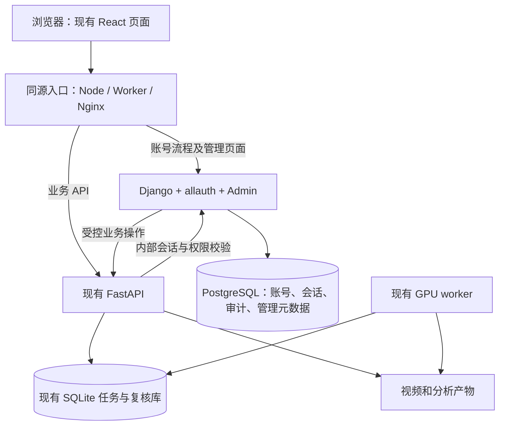

# 用户注册与管理后台：调研及实施规划

调研日期：2026-11-01（北京时间）  
状态：方案建议，等待项目负责人确定后实施。  
本轮分支：`codex/user-registration-plan`，从当前 `main` 的 `f25d718` 创建。原有未提交改动保留；本轮不实现业务功能、不迁移数据、不部署。

## 1. 选型结论

建议采用 **Django + django-allauth + Django Admin + PostgreSQL**，新增账号与管理服务，保留现有 **FastAPI + GPU worker** 的视频分析和评分链路。

- Django auth 管账号、密码、会话、用户组和权限。
- django-allauth 补注册、邮箱验证、找回密码等账号流程，Headless API 对接现有 React 页面。
- Django Admin 提供内部用户管理；任务、视频、报告和复核管理通过自定义管理视图对接现有服务。
- PostgreSQL 保存新增账号、权限、会话、操作审计和必要的业务管理元数据。
- 现有任务 SQLite、视频文件、评分产物和复核库第一期继续保留，不为注册功能重写推理系统。

这是根据本项目“既需要注册，也需要运营管理数据”作出的工程选择。以下是成熟产品路线的比较，**不是市场占有率排名**；本轮没有找到足以证明“大家都在用同一方案”的可靠统计。

## 2. 当前项目事实及影响

核查对象是当前工作区代码，包含已有未提交改动；部署示例不代表已核实线上运行状态。

1. **已有 FastAPI，没有完整个人账号体系。** `pyproject.toml:20` 定义服务依赖；`src/rallymate_service/api.py:557` 的 `authorize()` 只验证共享 Bearer API key，不能识别具体用户。
2. **浏览器入口会自动注入共享密钥。** `scoring-demo-web/worker/gateway.ts:247`、`deploy/nginx-rallymate.conf.example:115` 和 `scoring-demo-web/vite.config.ts:72` 都有相关代理逻辑。必须同时补齐业务接口鉴权，不能仅隐藏前端页面。
3. **任务存储是原生 SQLite。** `src/rallymate_service/database.py:16` 定位为单 GPU 节点、单 worker 队列；`:43` 的任务表没有个人归属字段。它不能直接作为现成 Django ORM / SQLAlchemy 管理模型使用。
4. **数据管理不仅是管理一张表。** 任务、视频文件、报告、上传 manifest、指标证据和技术复核分布在不同存储中。`technical_review.py:281` 的复核历史禁止更新与删除；管理操作必须保持其追加式历史。
5. **前端为 React + vinext，可通过 Node 或 Cloudflare 运行。** `scoring-demo-web/db/schema.ts:1` 仍为空脚手架，不能认为已具备用户数据库。
6. **训练记录有浏览器本地数据。** `scoring-demo-web/app/TrainingJournal.tsx:15` 等位置使用 localStorage。注册登录不会自动把名称、备注和关注点同步到后台；同步与历史导入需要独立工作。
7. **现有认证代理不能原样代理账号流程。** 当前分析代理过滤 Cookie、Authorization，并限制响应头；新账号路由必须正确处理 `Set-Cookie` 和 CSRF。FastAPI 当前 `allow_credentials=False`，第一期宜统一同源入口。

## 3. 常见成熟方案怎么选

### A. Django auth + allauth + Django Admin：本项目推荐

账号能力、模型管理、用户组和权限在同一 Python 生态内，适合持续扩展运营后台。Admin 定位是可信内部人员的管理工具；复杂任务流程仍应写专用视图。官方资料：[Django auth](https://docs.djangoproject.com/en/5.2/topics/auth/)、[Django Admin](https://docs.djangoproject.com/en/5.2/ref/contrib/admin/)、[allauth 功能](https://docs.allauth.org/en/latest/introduction/index.html)。

成本是新增服务、数据库迁移管理、邮件发送和跨服务认证适配。它不会自动管理现有视频文件及 SQLite 队列。版本建议以 Django 5.2 LTS 的受支持补丁版作为稳定基线；官方支持期至 2028 年 4 月，具体依赖在实施时锁定并验证兼容性。[官方支持周期](https://www.djangoproject.com/download/)

### B. FastAPI Users + SQLAdmin / Starlette-Admin：轻量备选

保留单一 FastAPI 框架，组合注册库和管理界面。FastAPI Users 提供注册、登录、验证、密码重置等，但官方已宣布进入维护模式：继续安全与依赖更新，不再新增功能。这不等于停更；对于希望长期扩展的账号系统，不作为本项目默认路线。[官方维护声明](https://github.com/fastapi-users/fastapi-users)

SQLAdmin 适合 SQLAlchemy / SQLModel；当前官方提供可选认证接入、授权/RBAC 和审计扩展，不能简单说它“没有权限或审计”。但这些需要配置集成，现有原生 sqlite3 数据也要适配。Starlette-Admin 提供类似后台扩展路线，均不是安装后便完整运行的注册产品。[SQLAdmin 认证](https://smithyhq.github.io/sqladmin/authentication/)、[授权](https://smithyhq.github.io/sqladmin/authorization/)、[审计](https://smithyhq.github.io/sqladmin/cookbook/audit_logging/)、[Starlette-Admin](https://jowilf.github.io/starlette-admin/user-guide/auth/)

如果“尽量少部署一个服务”优先于“完整、持续扩展的管理后台”，可以重新选择此路线；当前不推荐自行拼写密码、验证码和令牌算法。

### C. Keycloak：有统一身份与多系统登录需求时考虑

提供注册、邮箱验证、密码重置、MFA、用户/角色/会话管理。Python 通过 OIDC 接入；Keycloak 本体不是 Python 服务。适合自托管 SSO 和多个产品统一账号，但需维护额外身份系统和数据库。其控制台管理身份，视频、任务和报告仍需本项目后台。[管理指南](https://www.keycloak.org/docs/latest/server_admin/)、[OIDC 接口](https://www.keycloak.org/securing-apps/oidc-layers)、[生产部署](https://www.keycloak.org/server/configuration-production)

### D. Supabase Auth：接受托管 PostgreSQL 平台时的备选

提供密码、验证码、社交登录等能力，有官方 Python 注册和管理 API，也可自托管。Studio 可管理数据库表，适合工程人员，但不会自动建立任务状态机、复核流程和运营权限。既有 FastAPI 可继续保留，不必为使用 Auth 迁移评分服务。[Auth](https://supabase.com/docs/guides/auth)、[Python 注册](https://supabase.com/docs/reference/python/auth-signup)、[服务端管理 API](https://supabase.com/docs/reference/python/admin-api)、[自托管边界](https://supabase.com/docs/guides/self-hosting)

实际邮件、短信渠道和目标部署地区的连接体验需要验证；不在未验证时承诺可直接落地。后台高权限密钥只能用于服务端。

### E. Auth0：希望购买托管身份服务时考虑

有托管登录与用户管理、官方 FastAPI / Python SDK，适合减少身份系统运维或需要企业身份连接的团队。它是商业托管方案，费用和套餐能力需要在采用时核对；同样不能替代业务数据后台。[FastAPI Web SDK](https://github.com/auth0/auth0-fastapi)、[API SDK](https://github.com/auth0/auth0-fastapi-api)、[Python 管理 SDK](https://github.com/auth0/auth0-python)

## 4. 注册在 Python 后端通常如何实现

建议第一期以“邮箱 + 密码”为默认设计假设，手机短信、微信登录和无密码登录留作后续选项；尚未代用户确定这些产品偏好。

1. 前端提交邮箱和密码；后端规范化邮箱、校验格式及密码策略，使用数据库唯一约束处理重复与并发注册。
2. 密码由成熟框架生成加盐密码哈希，数据库不存明文。注册接口不能接受管理员、用户组等提权字段。
3. 创建待验证账号，发送有有效期的邮箱验证链接或验证码；限制注册、验证、重发和找回密码频率。
4. 验证成功后允许进入下一步。共享数据阶段建议使用邀请或管理员激活，控制实际可进入业务空间的人；这属于推荐产品策略，不是注册框架强制要求。
5. 登录由账号服务校验凭证与账户状态，创建服务端 session；浏览器通过 `HttpOnly`、`Secure`、合适 `SameSite` 的 Cookie 携带会话标识。
6. 业务请求验证会话、账号状态和操作权限；修改操作校验 CSRF。退出、重置密码和管理员停用需按明确规则撤销相应会话。
7. 审计记录操作者、动作、对象、结果、时间及请求标识；不记录密码、验证码或完整凭证。

allauth 官方区分浏览器 Cookie + CSRF 与非浏览器 token 流程，可直接提供前端所需账号 API。安全基础使用框架能力，并做配置和业务适配。[Headless API](https://docs.allauth.org/en/latest/headless/openapi-specification/)、[OWASP 会话管理](https://cheatsheetseries.owasp.org/cheatsheets/Session_Management_Cheat_Sheet.html)

## 5. 推荐架构与必须补齐的适配层

路径设计建议：`/_allauth/` 为官方账号 API，`/accounts/` 为所需账号页面，`/admin/` 为后台，`/v1/` 继续为分析 API。路径以同一网站域名呈现，保留现有 React 用户页面。

**首期建议 Cookie + 服务端 session。** FastAPI 通过仅限可信服务调用的内部接口向 Django 验证会话、账号状态及操作权限，不自行解析 Django 私有会话结构。内部接口还需核验原业务请求的 CSRF/来源信息；不能因为内部校验请求本身通过机器认证，就跳过浏览器写请求的 CSRF 检查。

这是需要开发和测试的适配层，**不是 allauth 官方现成 FastAPI 插件**。内部调用应有服务身份、可信传输和超时，鉴权失败或服务不可用时拒绝受保护操作。首期不缓存成功鉴权结果，确保停用用户、撤销会话后下一次请求被拒绝；已经开始的长上传或流式读取不承诺中途即时终止。

对现有代码的具体要求：

- `api.py` 的认证依赖应返回可验证的用户/服务身份；权限检查放在业务入口。浏览器传来的 `X-User-ID` 不能直接成为身份依据。
- 现有共享 API key 继续只用于可信服务之间，不能替代浏览器用户 session。交互请求同时满足服务入口与用户权限要求；运维机器身份使用独立、受限的内部通路，不提供匿名回退。
- Worker、Node、Nginx、本地开发代理都要遵守相同约定，不能存在自动注入 key 后绕过用户登录的路径。原视频、产物和 HTML 报告读取也在保护范围内。
- 新增专用账号代理，正确转发 Cookie / CSRF 与多个 `Set-Cookie` 响应，不将旧分析代理的头部过滤规则直接套用。
- `/api/advice` 等前端服务端接口也需要账号与角色检查，不能只保护 Python 的 `/v1/`。
- Django Admin 默认登录不会自动经过 allauth。需显式统一登录入口，确保选定的限流和管理员 MFA 同样覆盖后台。[官方说明](https://docs.allauth.org/en/latest/common/admin.html)

如果之后需要移动端或独立公共 API，可评估 allauth JWT 或外置 OIDC。allauth 当前已有 JWT 策略，但只在 FastAPI 本地验签无法保证注销、封禁立即生效；仍须设计撤销或状态查询，不能把它当作省略会话管理的办法。[JWT 策略](https://docs.allauth.org/en/latest/headless/token-strategies/jwt-tokens.html)

## 6. 第一阶段能管理哪些数据

### 账号管理

查看、搜索和筛选账号；查看邮箱验证和启用状态、注册/最近登录时间；启停账号；分配角色；发送重置入口；撤销会话。管理员不能查看用户原密码。

建议普通成员、管理人员两类起步；需要多人运营后再拆出只读人员、复核人员和系统管理员。普通成员不能进入管理后台或调用管理接口；注册请求不能自行指定角色。

### 服务端业务数据管理

任务列表按时间、状态、文件名、任务编号筛选，查看视频、报告、错误和复核记录。第一期的受控写操作优先复用现有取消任务和追加复核接口；管理注释、标签可以保存在新增元数据表中。

后台通过业务 API / 只读索引接入原数据，不直接改 worker 租约、任务状态、评分数值或复核历史。现有全局任务查询需要补分页和后台筛选。重跑、永久删除、批量导出如要加入，单独定义幂等、文件清理和审计规则，不声称当前已提供。

用户数据库只保存必要记录和引用。视频、逐帧大文件和报告仍放原有文件存储；后续可以迁移对象存储，但不是注册功能的前置要求。管理索引若存在，应标记同步时间、可重建，以原服务数据为准。

### 本期不做的个人数据分区

- 不按用户分库、分表、建独立文件目录，不增加租户系统。
- 不按 `owner_id` 过滤业务数据；第一期为明确的共享业务空间。经批准进入该空间的成员可能看到其他成员的视频与报告，不能称为“私人账户数据”。
- 仍限制管理操作：取消任务、复核写入、角色变更和后台导出等默认仅管理人员可用；普通成员的界面同步调整。
- 新用户使用稳定 UUID；新操作预留 `actor_user_id` / `created_by` 追溯，历史数据标为未知或 legacy，不推断归属。这是审计预留，不是个人隔离。
- 浏览器本地训练日记同步、历史导入、个人记录归属与分享权限另立阶段。

在尚无个人隔离时，建议先做受控注册的共享测试空间。若要直接开放给互不认识的公众用户，应重新确定数据可见性范围；当前方案不把开放注册等同于全量数据公开。

## 7. 实施顺序与验收

### 第一步：验证账号与现有服务能正确贯通

下一轮先确定 UUID 自定义用户模型、`AUTH_USER_MODEL`、邮箱唯一规则及首批迁移，再实现最小 Django 账号服务、同源代理和 FastAPI 内部会话校验；用一个只读接口和一个写接口验证 Cookie、CSRF、角色、停用账号及故障拒绝访问。自定义用户模型必须在首次迁移前确定，避免后续替换默认用户模型。不先迁移评分与任务存储。

验收：Worker/Node/Nginx 等实际启用的入口行为一致；匿名和伪造用户头无法读取受保护业务；缺少 CSRF 的写请求失败；账号服务异常不会自动放行。通过此步再铺开功能。

### 第二步：完成账号闭环与后台用户管理

在首步账号模型基础上接入完整注册、验证、登录、退出、找回密码和管理后台；配置邮件服务与跨实例限流。开发环境邮件可进入本地收件箱，生产验收必须测试真实送达、链接域名和有效期。

验收：重复注册及并发请求不会创建重复账号；验证/重置凭证过期或使用后不能重放；普通用户不能提升权限；退出、重置与停用的会话规则可验证；后台管理员登录也受统一保护。

### 第三步：完成业务数据管理

新增任务查询和管理视图、角色检查、元数据及操作审计；复用已有取消与复核流程；盘点历史任务、文件引用和复核记录，不重写评分事实。

验收：后台能够找到历史任务；取消遵守原状态机；复核历史仍不可覆盖；管理写入有操作者；普通成员不能执行管理动作。训练日记不被误报为已完成服务端同步。

### 第四步：联合验收与上线准备

覆盖大文件分片上传、断点续传、报告 HTML/JSON、视频 Range、退出后访问、账号停用、后台权限及实际部署入口。验证账号库备份恢复，记录角色和邮件配置，更新部署文档。

回滚可以撤回账号功能部署，但不能把网站自动恢复为匿名访问敏感业务数据；必要时关闭受保护入口。角色与会话迁移先在测试数据库演练。

## 8. 下一轮开始前需要确定的产品选择

推荐默认值已经给出，不影响本轮调研结论：

1. **后台路线：** 推荐 Django + allauth + Admin；保留 FastAPI。
2. **首期注册方式：** 推荐邮箱 + 密码 + 邮箱验证；手机号/微信后续加入。
3. **数据可见性：** 当前按要求不做个人隔离，推荐邀请或审核激活的共享空间。
4. **管理范围：** 推荐先做账号、任务、视频/报告、复核记录与操作审计；本地训练日记同步另做。
5. **实际部署：** 实施前核实线上使用的 Node/Cloudflare/Nginx 路径、域名和邮件渠道；本次只核查了仓库配置。

本轮已完成分支创建、代码现状核查与官方资料调研；未安装依赖、未修改业务代码、未创建数据库、未发送邮件，也未执行上线操作。
